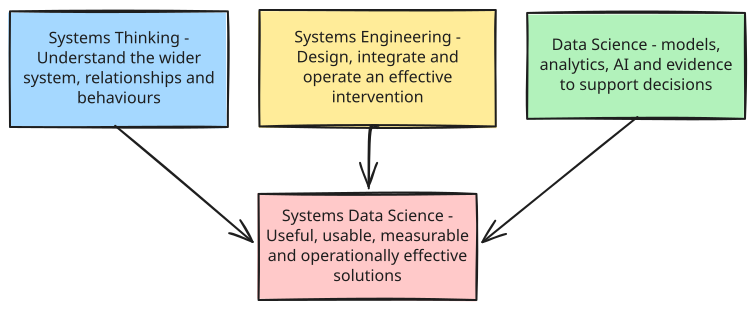

# Systems Data Science - an overview

*Piers Walker, July 2026*

Systems Data Science combines systems thinking, systems engineering and applied data science to develop solutions that work in practice.

The central idea is that an analytical model, machine learning system or AI tool is rarely useful in isolation. It operates within a wider system of people, processes, information, technology, policies and constraints.

A technically strong solution can still fail if users do not trust it, if it does not fit existing workflows, if the data is poorly governed, or if success is measured using metrics that do not reflect the real intended outcome.

Systems Data Science therefore looks beyond the individual tools. It asks how the analytical or AI components form their own system and subsequently interact with the wider system. It covers how they support real user's activities, how performance can be measured, and how the solution can operate reliably over time.

**🡺 Systems Data Science = Systems Thinking + Systems Engineering + Data Science**

## What Systems Data Science looks like in practice

Systems Data Science considers analytical and AI methods as components within wider socio-technical systems.

The key shift is in perspective: a data science model or AI tool is one component within a larger system. It will usually depend on data generated elsewhere, be used by people within an existing workflow, and produce outputs that may influence behaviour, decisions or other systems.

A narrow technical view might ask how the model is performing, whereas a systems view asks whether the intervention improves the outcome we actually care about.

For example:

| Narrow technical view           | Systems view                                         |
| ------------------------------- | ---------------------------------------------------- |
| Is the model accurate?          | Does the intervention improve the intended outcome?  |
| Are retrieval results relevant? | Can users find and apply the information they need?  |
| Is the interface usable?        | How does the tool change workflow and behaviour?     |
| Does the model work today?      | How does the wider system learn and adapt over time? |

Applying systems thinking can help avoid:

* optimising the wrong metric
* building technically excellent tools that nobody uses
* ignoring human and organisational factors
* shifting risk or workload elsewhere in the system

The value of a project does not depend on the model alone. It depends on the interaction between information, technology, organisational context, human understanding and the decisions or outcomes that follow.

## Questions a systems thinker might ask about a data science product

A systems-thinking approach changes the questions we ask.

| Area                        | Questions to consider                                                                                                                                                                                                  |
| --------------------------- | ---------------------------------------------------------------------------------------------------------------------------------------------------------------------------------------------------------------------- |
| **Data**                    | Where does the data come from, and why was it generated? What biases, gaps or assumptions might be present? Who owns and maintains the data? How quickly does it become out of date?                          |
| **Users**                   | Who uses or acts on the outputs? What actions or decisions are they trying to make? What level of explanation do they need? How might their behaviour change once the tool is available?                      |
| **Workflow**                | Where does the tool fit into existing workflows? What happens if the tool is ignored, misused or relied upon too heavily? What teams, systems or processes are affected?                                         |
| **Feedback**                | How can users provide feedback? How will errors, edge cases and unexpected uses be detected? How will the system be updated over time?                                                                           |
| **Outcomes**                | What outcomes should improve, and how will we know? Are we measuring model performance, user experience, operational outcomes or organisational effects? Over what period should benefits and harms be assessed? |
| **Unintended consequences** | Could the tool create incentives for unhelpful behaviour? Could it move work, risk or responsibility onto another part of the organisation? What might happen if people over-trust or under-trust it?            |

## A practical Systems Data Science approach

In practice, Systems Data Science means looking beyond the model across the whole lifecycle of an intervention.

* **Understand the wider system** – the problem, users, workflows, data, constraints and dependencies.
* **Design the intervention** – develop the analytical or AI components alongside the processes, interfaces and controls around them.
* **Integrate with real workflows** – make sure the solution fits how people and organisations actually work.
* **Evaluate at multiple levels** – consider technical performance, user outcomes, operational effects and organisational impact.
* **Learn and improve** – use monitoring, feedback and failure analysis to adapt both the technical solution and the wider system.

## The aim of Systems Data Science

Systems Data Science combines technical data science with a wider understanding of the system in which it operates.

The aim is to build analytical and AI-enabled solutions that are not only technically capable, but also useful, usable, measurable, responsible and operationally effective.

This means asking not only whether the model works, but whether the wider intervention helps people make better decisions, improves the outcomes that matter and continues to work effectively as the surrounding system changes.

Systems thinking does not replace technical excellence in data science; it gives it somewhere useful to land.

For a more detailed discussion of systems thinking, systems engineering, practical examples, evaluation and responsible AI, see [Systems Data Science in detail](https://pierswalker71.github.io/systems_data_science_in_detail).

---
**←[Back to home page](https://pierswalker71.github.io)**
