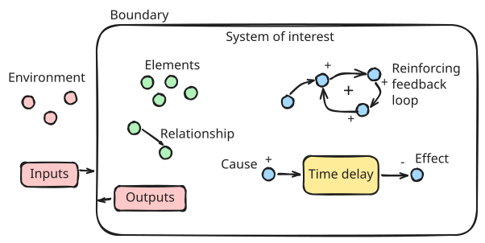
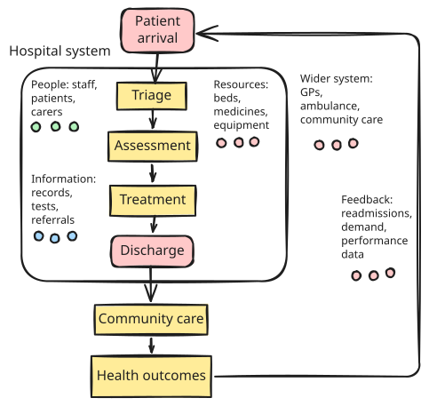
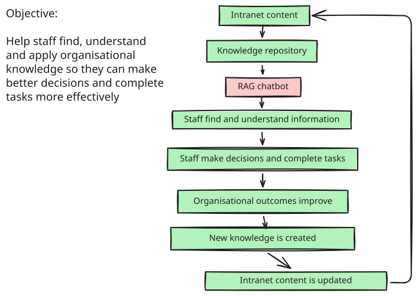
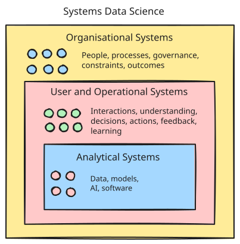

# Systems Data Science in detail

This page expands on the main Systems Data Science overview by exploring the systems-thinking concepts, systems engineering approach, practical examples, evaluation and responsible AI considerations behind it.

## Contents

- [A practical Systems Data Science approach](#a-practical-systems-data-science-approach)
- [What is systems thinking?](#what-is-systems-thinking)
- [Some useful systems concepts](#some-useful-systems-concepts)
- [A hospital as a system](#a-hospital-as-a-system)
- [From systems thinking to systems engineering](#from-systems-thinking-to-systems-engineering)
- [Case study: an internal AI chatbot](#case-study-applying-systems-data-science-to-an-internal-ai-chatbot)
- [Responsible and safe AI](#responsible-and-safe-ai)
- [Systems Data Science summary](#systems-data-science-summary)

## A practical Systems Data Science approach

One practical way to think about Systems Data Science is as a continuous process of understanding, designing, integrating, evaluating and improving.

**Understand the wider system** – define the problem, system boundary, users, stakeholders, workflows, data sources, constraints and dependencies. Look beyond the immediate technical task to understand the outcome the intervention is intended to improve.

**Design the intervention** – develop the analytical or AI components alongside the surrounding processes, interfaces, controls and responsibilities needed for them to work effectively.

**Integrate with real workflows** – consider how the solution will operate within existing technology, organisational processes and decision-making. A technically successful model may still fail if it introduces friction or does not fit the way people actually work.

**Evaluate at multiple levels** – measure more than model performance. Consider technical quality, user understanding and task completion, operational effects and wider organisational outcomes.

**Learn and improve over time** – use monitoring, feedback, failure analysis and changing user needs to improve both the technical components and the wider system in which they operate.

Systems thinking provides the foundation for understanding that wider context.

## What is systems thinking?

Systems thinking is a way of understanding problems where people, technology, processes, information and incentives interact.

Complex problems are often approached by breaking them into smaller parts and examining each part separately. This reductionist approach is extremely useful, particularly for understanding complicated technologies.

However, it can be less effective when behaviour arises from interactions between components rather than from the components alone.

Systems thinking therefore looks at the system as a whole as well as its individual parts. It considers relationships, dependencies, feedback and the wider environment in which the system operates.

A business or organisation, for example, can be viewed as a system of people, policies, processes, technology and information. Organisational culture is not contained in any one of these elements; it emerges from their interactions.

Changing one part of a system can therefore have effects elsewhere, including effects that are delayed or difficult to predict.

## Some useful systems concepts

Useful concepts include:

* **System of interest** – the system or problem area being considered
* **System boundary** – what is included within the system being studied
* **Environment** – the wider context outside the boundary
* **Inputs and outputs** – information, resources or actions entering and leaving the system
* **Elements** – the individual parts that make up the system
* **Relationships** – how elements interact with and influence one another
* **Feedback loops** – where changes in one part of the system eventually influence that same part again
* **Time delays** – gaps between an action and its effects
* **Emergence** – behaviour or properties arising from interactions across the system rather than from any individual component

Feedback loops can either reinforce change or act to balance it. Time delays can make systems harder to understand because the consequences of an action may only become visible much later.

Here is an illustration of some of these components:

## A hospital as a system

Consider a hospital.

At first glance it may look like a collection of departments: A&E, wards, diagnostics, theatres, pharmacy and discharge teams.

From a systems perspective, it is better understood as a network of people, resources, information and processes working together to improve patient outcomes.

The hospital also operates within a wider system that includes GPs, ambulance services, community care, social care, staffing, funding, regulation and patient demand.

This matters because the place where a problem becomes visible is not necessarily the place where its cause sits.

A&E congestion, for example, may partly result from delayed discharge, which may itself be affected by the availability of community or social care.

### Understanding the system using POTI

One simple way of avoiding an overly technology-focused view is to examine the system through **Process, Organisation, Technology and Information (POTI)**.

| POTI category | Examples in a hospital system |
| --- | --- |
| **Process** | admission, triage, diagnosis, treatment, discharge, follow-up care |
| **Organisation** | patients, nurses, doctors, administrators, managers, carers and clinical teams |
| **Technology** | patient record systems, diagnostic equipment, monitoring devices and scheduling systems |
| **Information** | patient records, test results, referrals, clinical guidance, bed status and discharge plans |

Other important considerations include resources, constraints and the wider environment.

| Category | Examples |
| --- | --- |
| **Resources and constraints** | beds, medicines, staff time, funding, physical space, theatre capacity |
| **Wider system** | GPs, ambulance services, community care, social care, public health and regulation |

## From systems thinking to systems engineering

Systems thinking helps us understand the wider problem and the relationships between different parts of a system.

Systems engineering focuses on turning that understanding into a designed, integrated and operable solution.

For a data science project, this might include:

* defining the operational need
* identifying users and stakeholders
* understanding workflows and dependencies
* translating needs into requirements
* integrating data, models, interfaces and existing technology
* considering reliability, safety and maintainability
* testing whether the complete solution works in practice
* monitoring performance and improving the system over time

The combination is useful: systems thinking helps us understand the problem landscape, while systems engineering helps us design and operate an effective intervention within it.

## Case study: applying Systems Data Science to an internal AI chatbot

<mark>Expand to view case study of applying Systems Data Science to an internal AI chatbot</mark>

### Introduction

Consider an internal chatbot that uses Retrieval Augmented Generation (RAG) to help staff find and understand HR policies and guidance from an organisation's intranet.

A narrow technical framing might be:

> Generate accurate answers to user queries using a set of documents.

A systems framing is broader:

> Help staff find, understand and apply organisational knowledge so they can make better decisions and complete tasks more effectively.

The second framing changes the problem. The chatbot becomes one component within a wider organisational knowledge system.

### Technical versus systems perspective

An exclusively technical perspective might focus on embeddings, retrieval, the vector database, the language model and the system prompt.

A systems perspective also considers the surrounding information, people, workflows, governance and feedback.

A useful way to represent the wider system is through POTI:

| POTI category | Examples |
| --- | --- |
| **Process** | content creation, review, publishing, search, chatbot use, escalation, feedback and maintenance |
| **Organisation** | staff users, content owners, subject matter experts, HR teams and sponsors |
| **Technology** | intranet, search service, RAG pipeline, vector database, language model and monitoring tools |
| **Information** | policies, guidance, source documents, user feedback and usage data |

The quality of a chatbot response depends on interactions across these components. A poor answer may originate in the source information, content-management process, retrieval system, model behaviour, interface or user interaction.

Treating every poor answer as an LLM problem risks improving the wrong part of the system.

### Looking across the user journey

Many RAG projects focus primarily on retrieval and answer quality. A systems perspective considers the interaction before, during and after the chatbot response.

| Stage | Questions to consider |
| --- | --- |
| **Before the chatbot** | Is the information accurate and current? Is it duplicated or contradictory? Who owns and maintains it? |
| **During the interaction** | Can users formulate effective questions? Will they understand and appropriately trust the answer? Can they access and verify the source material? |
| **After the interaction** | Did the user complete their task? Did they still need to contact HR or another support team? Did the interaction reveal gaps in organisational knowledge? |

### Looking upstream for causes

When a user reports a poor answer, the same visible symptom can have several possible causes.

| User complaint | Possible root cause |
| --- | --- |
| Missing information | poor retrieval, incorrect chunking, missing source content or outdated information |
| Incomplete answer | relevant content retrieved but not used effectively |
| Vague answer | ambiguous question, unclear source material or irrelevant retrieval |
| Cannot verify the answer | supporting sources or links are not clearly exposed |
| Difficult to use the answer | interface or presentation does not support the user's task |

Improving the model will not solve a content-governance problem. Improving retrieval will not solve an ambiguous policy. Changing the interface will not help where the required information does not exist.

### Feedback and emergent behaviour

Interactions within the wider system can create feedback loops.

For example:

> Better answers → greater trust → more use → more feedback → system improvement → better answers

The opposite can also happen. Poor early performance may reduce trust and adoption, resulting in less feedback and slower improvement.

Other effects may emerge over time. Staff may become more self-sufficient, demand on support teams may change, or users may begin to over-trust automated answers.

These effects cannot be understood from model performance alone.

### Evaluating the complete intervention

Systems Data Science therefore evaluates performance at multiple levels.

| Measure type | Example measures |
| --- | --- |
| **Technical** | retrieval precision and recall, groundedness, answer accuracy, response time |
| **User** | task completion, time to find information, understanding, satisfaction, calibrated trust |
| **Operational** | demand on support teams, repeated enquiries, time spent finding information |
| **Organisational** | policy compliance, knowledge sharing, content quality, productivity or time saved |

A model can meet its technical targets while the overall intervention fails to improve user or organisational outcomes.

Operational effectiveness also depends on whether the system can be maintained and governed in real use. This includes understanding what happens when data is missing, how failures are detected, how uncertainty is handled, who responds to problems and how models, prompts or source content are updated.

## Responsible and safe AI

A systems-thinking approach considers responsible AI across the whole system rather than treating it as a final technical check.

Risks can arise from data, model behaviour, system design, interfaces, workflows and organisational processes. In systems using large language models, additional risks can include unsupported claims, sensitivity to phrasing, inconsistent outputs and attempts to manipulate the system.

### Fairness and bias

Bias can enter through data, model behaviour, design choices and the way outputs are used.

Useful approaches include:

* **paired or counterfactual testing** – varying characteristics while keeping other parts of the input equivalent
* **performance comparisons** – checking whether accuracy, completeness, relevance or error rates differ across groups or scenarios
* **coverage testing** – identifying poorly represented groups, topics or situations
* **consistency testing** – checking whether similar inputs receive appropriately similar outputs
* **language robustness testing** – examining whether spelling or different ways of expressing the same request materially affect performance

### Safety and trustworthiness

Responsible AI assurance should also consider:

* **accuracy and reliability** – whether outputs are correct, complete enough and suitable for the intended use
* **safety** – whether the system responds appropriately to sensitive, ambiguous, adversarial or unexpected inputs
* **privacy and confidentiality** – whether personal or sensitive information could be exposed
* **security and robustness** – whether safeguards can be bypassed or confidential information extracted
* **transparency and explainability** – whether users understand the role, limitations and appropriate level of trust in the AI

### Governance and monitoring

Responsible AI continues after deployment.

The system should have clear arrangements for:

* human oversight and escalation
* monitoring errors and failed interactions
* collecting and responding to user feedback
* identifying changing usage patterns or data
* defining ownership and accountability
* deciding whether the system remains appropriate for continued use

From a systems perspective, the important question is not only whether an individual model is fair, accurate or safe. It is whether the interaction between data, models, interfaces, people and operational processes produces outcomes that are fair, safe, trustworthy and appropriate for the intended purpose.

## Systems Data Science summary

Systems Data Science combines systems thinking, systems engineering and applied data science.

It treats analytical models and AI tools as components within wider systems of people, processes, information, technology, policies and constraints.

The important questions are therefore not only:

> Does the software work or is the machine learning model accurate?

They also include:

> Does the tool fit the workflow and wider operational system?

> Does it help users understand something better, perform a task more effectively or make better decisions?

> Is it fair, safe, trustworthy and appropriately governed?

> Can it perform reliably and improve over time?

> Does it create meaningful benefits without introducing unacceptable unintended consequences?

For a RAG chatbot, this means looking beyond retrieval and answer generation. The wider challenge is to improve how organisational knowledge is created, maintained, discovered, understood and acted upon.

Systems thinking does not replace technical excellence in data science; it gives it somewhere useful to land.

The aim of Systems Data Science is to build analytical and AI-enabled solutions that are not only technically capable, but useful, usable, measurable, responsible and operationally effective.
